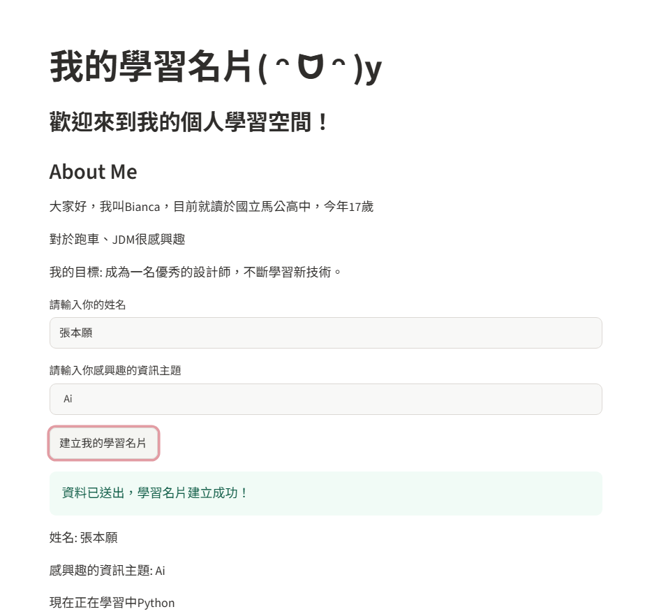

# W09｜My First Streamlit App
## 一、作品介紹
本作品使用 Python 與 Streamlit 製作。
透過網頁輸入欄位與按鈕，讓使用者建立自己的學習名片。
這是第一次將 Python 程式轉換成可以透過瀏覽器操作的 Web App。
### 作品畫面預覽

## 二、使用技術
- Python
- Streamlit
- VS Code
## 三、作品功能
1. 顯示網頁標題與歡迎文字。
2. 輸入姓名。
3. 輸入感興趣的資訊主題。
4. 點擊建立名片按鈕。
5. 檢查必要資料是否完整。
6. 顯示學習名片內容。
## 五、安裝套件
在 Terminal 輸入：
python -m pip install streamlit
## 六、執行方式
在專案資料夾中開啟 Terminal，輸入：
python -m streamlit run app.py
接著使用瀏覽器開啟 Streamlit 提供的本機連線位置。
## 七、本週學習重點
- 認識 Streamlit。
- 使用 Python 建立網頁介面。
- 使用 st.title() 與 st.write()。
- 使用 st.text_input() 取得使用者輸入。
- 使用 st.button() 觸發程式。
- 使用 if 判斷輸入資料。
- 將 Python 程式呈現在瀏覽器中。
## 八、學習反思
Q1. Streamlit 與一般 Python 程式有什麼不同？

A1. 是利用瀏覽器瀏覽，內建按鈕具互動性

Q2. 使用網頁輸入欄位有什麼優點？

A2.視覺更直覺、可以及時提醒使用者哪一個欄位輸入有問題

Q3. 我希望未來的 Web App 加入什麼功能？

A3. 加入AI能依照使用者的回應，給予適當的回饋，有種跟朋友、知己聊天的感覺
